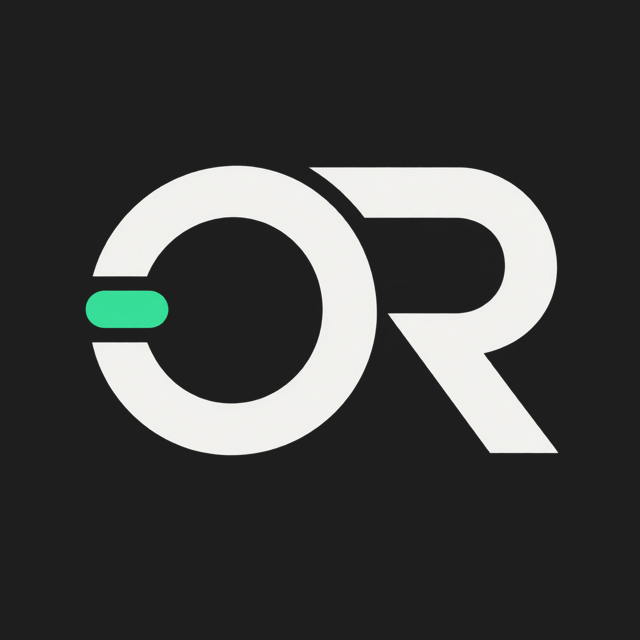
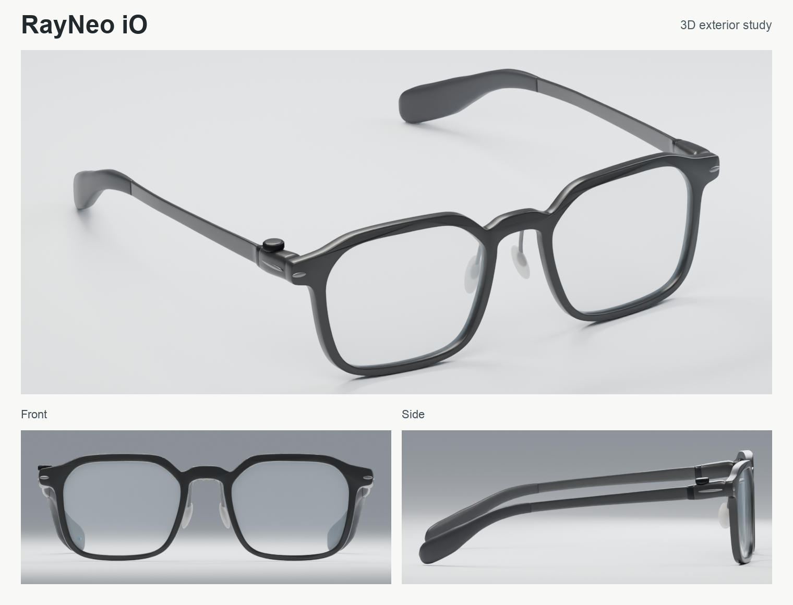

<div align="center">



# OpenRayneo

**Open-source macOS & Android companion and local Agent bridge for RayNeo iO smart glasses**

<p>
  <a href="README.md">简体中文</a> · <strong>English</strong>
</p>

<p>
  <a href="https://github.com/Tobi1chi/OpenRayneo/releases/tag/v1.2.0-beta.5"></a>
  
  
  
  <a href="LICENSE"></a>
</p>

<p>
  <a href="#features">Features</a> ·
  <a href="#quick-start">Quick Start</a> ·
  <a href="#architecture--documentation">Architecture &amp; Docs</a> ·
  <a href="#contributing">Contributing</a>
</p>

<br />



</div>

---

## Overview

OpenRayneo is an independent open-source companion for **RayNeo iO** smart glasses. It exposes the device's native Bluetooth display, dual-channel microphone capture, local ASR/speaker processing, daily recording management, and local Agent APIs:

- **macOS (`OpenRayneoBridge`)**: Built for desktop workflows, virtual microphone routing, local HTTP API automation, recording review, and protocol testing.
- **Android (`OpenRayneo`)**: Built for everyday wearable use, turn-by-turn navigation mirroring, on-device conversation recording, and local mobile Agent (`DSH Go`) workflows.

> Official RayNeo cloud/account features remain disabled in the current beta. Hardware firmware and native device protocols define the capability boundary; see [`.arch/ground_truth.md`](.arch/ground_truth.md) for current verified facts and open items.

---

## Features

| Area | macOS (`OpenRayneoBridge`) | Android (`OpenRayneo`) |
| --- | --- | --- |
| **Bluetooth & Protocol** | BLE auth + RFCOMM data channel with dynamic extended headers, async ACKs, and single-byte sliding resync | Direct BLE + SPP connection, `BleIdentityGate` guard for early/duplicate MTU callbacks, and serial SPP ACKs |
| **Audio & Virtual Mic** | CoreAudio HAL driver `v0.3.0` (Universal `arm64 + x86_64`, hidden write sinks, lock-free 64-bit C11 atomic ring buffer, auto `coreaudiod` reload on install) | Real-time Opus decoding (with malformed TOC validation), on-device speaker recognition & self-learning, encrypted recordings & WAV export |
| **Display & HUD** | Live prompts/captions, teleprompter, notification forwarding, character video (with aspect-ratio letterboxing), live 3D glasses stage | Amap (Gaode) turn-by-turn mirroring (roundabouts, ramps, U-turns, arrival) on a strict Unicode-safe `20×5` grid, live 3D glasses stage |
| **Agents & Switching** | Hardened localhost-only HTTP API (`127.0.0.1:8765`, constant-time Bearer auth, DNS Rebinding Host check), LAN phone record sync | **One-tap switching to/from the official RayNeo app** without unlinking or clearing data, local Agent API & DSH Go plugin |
| **Bilingual UI (i18n)** | Runtime language switcher (`System / 简体中文 / English`) in the sidebar | Standard Android `strings.xml` + runtime switcher (`System / 简体中文 / English`) in Settings |

---

## Quick Start

### 1. Prebuilt Releases

Download the latest candidate from [GitHub Release v1.2.0-beta.5](https://github.com/Tobi1chi/OpenRayneo/releases/tag/v1.2.0-beta.5):

- **macOS**: Signed Apple Silicon `.zip` app bundle (includes the built-in virtual microphone `.pkg` installer)
- **Android**: `arm64-v8a` Release APK (uses APK v3 key rotation lineage from `v1.2.0-beta.5` onward for seamless in-place upgrades over earlier debug builds)
- **DSH Go Plugin**: `openrayneo-dsh-0.1.8.tgz`

### 2. Build & Test from Source

**macOS (Apple Silicon · macOS 15 · Xcode Command Line Tools)**

```sh
sh scripts/prepare-mac-voice.sh
swift build
OPENRAYNEO_APP_DIR="$PWD/.build/dev-candidate/OpenRayneoBridge.app" sh scripts/build-app.sh
open .build/dev-candidate/OpenRayneoBridge.app
```

**CoreAudio Virtual Microphone Driver & C11 Concurrency Tests**

```sh
clang -std=c11 -O2 -Wall -Wextra -Werror -pthread Tests/AudioDriverTests/test_audio_ring.c -o /tmp/test_audio_ring && /tmp/test_audio_ring
sh scripts/build-audio-driver.sh
```

**Android (JDK 17 · Android SDK 36)**

```sh
cd android
./gradlew :app:testDebugUnitTest
./gradlew :app:assembleDebug
```

> For detailed setup, release signing rotation, DSH Go plugin installation, speaker calibration, and Bluetooth recovery steps, see the [Runbook (`docs/runbook.md`)](docs/runbook.md).

---

## Architecture & Documentation

`.arch/` is the single source of truth for system architecture, verified facts, and open decisions:

- [Architecture Dashboard](.arch/dashboard.html) — Interactive graph generated from `.arch/graph.json`
- [Ground Truth & Open Issues](.arch/ground_truth.md) — Verified constraints, current implementation, and known gaps
- [North Star (`SEED.md`)](.arch/SEED.md) & [Graveyard](.arch/graveyard.md) — Goals and retired design decisions
- [Agent & Repo Conventions (`AGENTS.md`)](AGENTS.md) — Rules for maintaining architecture, code, and lean docs

Update or inspect architecture nodes via `arch-grower`:

```sh
uv run ~/.agents/skills/arch-grower/scripts/arch_cli.py focus --node speaker_channel_policy
uv run ~/.agents/skills/arch-grower/scripts/arch_cli.py export-ui --out .arch/dashboard.html
```

### Operational & Contract Guides

| Topic | Document |
| --- | --- |
| Install, build, Bluetooth recovery, DSH Go & audio diagnostics | [docs/runbook.md](docs/runbook.md) |
| Wire framing, authentication, control lifecycle & protocol evidence | [docs/protocol.md](docs/protocol.md) |
| Phone-to-Mac recording sync, cursors & write-back contract | [docs/record-sync-contract.md](docs/record-sync-contract.md) |
| macOS localhost HTTP API routes & helper scripts | [.agents/skills/openrayneo-api/SKILL.md](.agents/skills/openrayneo-api/SKILL.md) |
| Mobile DSH Go Agent plugin | [integrations/dsh-go/README.md](integrations/dsh-go/README.md) |

---

## Contributing

Contributions, bug reports, translations, and hardware test feedback are very welcome! Please read:

- [Contributing Guide](CONTRIBUTING.md)
- [Code of Conduct](CODE_OF_CONDUCT.md)
- [Security Policy](SECURITY.md)

Thanks to community contributors [@VanceHud](https://github.com/VanceHud) (CoreAudio driver v0.3.0, cross-platform hardening & unit tests), [@ruchirlives](https://github.com/ruchirlives) (English Android exploration, BLE MTU fix & official app switching), and everyone testing on real hardware.

---

## License & Disclaimer

Licensed under the [Apache License 2.0](LICENSE). OpenRayneo is an independent open-source project not affiliated with RayNeo; official APKs, firmware images, personal recordings, and signing credentials are never distributed with this repository.
