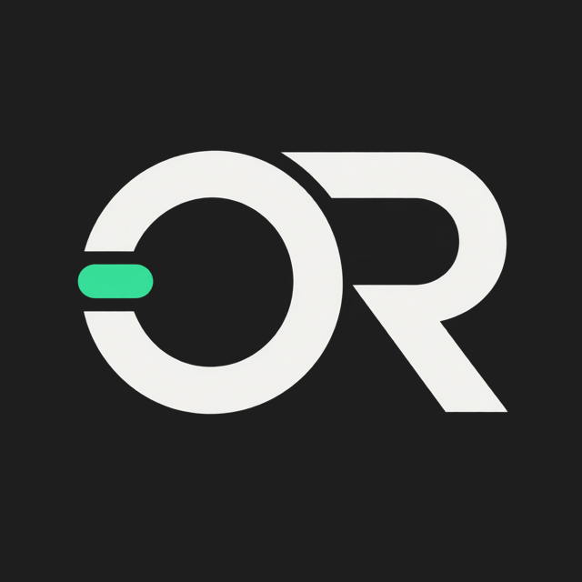

# OpenRayneo



RayNeo iO 眼镜的 macOS / Android 伴侣。引出眼镜已有能力，完成采集、基础处理、记录与本机 Agent 接入。Mac 侧重工作流扩展和测试，手机侧重日常易用与全天记录。

## 架构是项目主文档

- [架构看板](.arch/dashboard.html)：由 `.arch/graph.json` 生成的当前节点与契约。
- [事实、当前实现与未解决问题](.arch/ground_truth.md)：开发和验收的当前基线。
- [北极星](.arch/SEED.md)与[废弃方案](.arch/graveyard.md)：目标与取舍依据。
- [开发约定](AGENTS.md)：维护架构、代码和精简文档的规则。

在仓库根目录使用 `arch-grower`：

```sh
uv run ~/.agents/skills/arch-grower/scripts/arch_cli.py focus --node speaker_channel_policy
uv run ~/.agents/skills/arch-grower/scripts/arch_cli.py export-ui --out .arch/dashboard.html
```

架构图通过 CLI 更新。节点决策、当前实现、已验证结果和未解问题分别维护；新的工作更新现有事实与节点。

## 仅保留必要的操作与合同

| 需要做什么 | 入口 |
| --- | --- |
| 安装、构建、连接、DSH、声音调试与故障恢复 | [运行指南](docs/runbook.md) |
| 设备帧、认证、控制生命周期与逆向证据索引 | [核心协议](docs/protocol.md) |
| 手机记录与 Mac 副本、游标、派生写回 | [同步契约](docs/record-sync-contract.md) |
| Mac 本机 HTTP API、参数与请求脚本 | [API 技能](.agents/skills/openrayneo-api/SKILL.md) |
| 手机本机 DSH Agent 插件 | [插件说明](integrations/dsh-go/README.md) |

当前候选包和质量问题见[实现快照](.arch/ground_truth.md#当前实现与未解决问题)。官方账号／官方云服务分支在当前 Beta 停用；眼镜固件及官方已具备的功能构成设备能力边界。

[Apache License 2.0](LICENSE)。本项目独立于 RayNeo；官方 APK、固件、用户录音与凭据不随源码分发。
