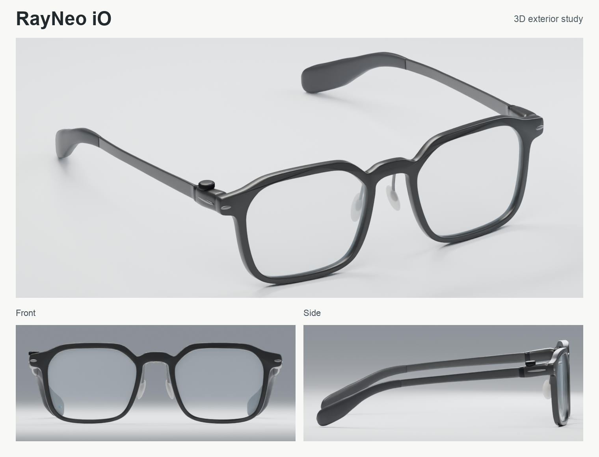

<div align="center">


# OpenRayneo

**RayNeo iO 智能眼镜的开源 macOS / Android 伴侣与本机 Agent 接入层**

<p>
  <strong>简体中文</strong> · <a href="README.en.md">English</a>
</p>

<p>
  <a href="https://github.com/Tobi1chi/OpenRayneo/releases/tag/v1.2.0-beta.5"></a>
  
  
  
  <a href="LICENSE"></a>
</p>

<p>
  <a href="#核心能力">核心能力</a> ·
  <a href="#快速开始">快速开始</a> ·
  <a href="#架构是项目主文档">架构与文档</a> ·
  <a href="#参与贡献">参与贡献</a>
</p>

<br />



</div>

---

## 项目定位

OpenRayneo 面向 **RayNeo iO** 智能眼镜，引出设备已有能力，完成**蓝牙建链、双路收音、本地语音与声纹处理、全天记录以及本机 Agent 接入**：

- **macOS 端（`OpenRayneoBridge`）**：侧重桌面工作流扩展、虚拟麦克风路由、本机 HTTP API 自动化、录音回看与协议测试。
- **Android 端（`OpenRayneo`）**：侧重日常随身佩戴、高德导航跟随、全天会议/对话记录与手机本机 Agent（DSH Go）协作。

> 当前 Beta 分支停用官方账号／官方云服务；眼镜固件及官方已有协议构成设备能力边界，详见 [实现快照](.arch/ground_truth.md#当前实现与未解决问题)。

---

## 核心能力

| 维度 | macOS (`OpenRayneoBridge`) | Android (`OpenRayneo`) |
| --- | --- | --- |
| **蓝牙与协议** | BLE 认证 + RFCOMM 数据通道，支持动态扩展头、异步 ACK 回发与单字节流式滑窗自愈 | 手机直连 BLE + SPP，含 `BleIdentityGate` 防早期/重复 MTU 回调空指针及串行 ACK |
| **音频与虚拟麦克风** | CoreAudio HAL 驱动 `v0.3.0`（`arm64 + x86_64` Universal Binary、隐藏 Sink 不污染输出列表、64 位 C11 原子环形缓冲、`postinstall` 自动重载 `coreaudiod`） | Opus 实时解码（含畸形 TOC 校验）、本机声纹识别与自学习、本地加密录音与 WAV 导出 |
| **显示与交互** | 实时提示/字幕、提词器、通知转发、字符视频（支持保比例黑边填充）、3D 眼镜状态舞台 | 高德导航通知跟随（支持环岛/匝道/掉头/到达与 `20×5` Unicode 防越界网格）、3D 眼镜舞台 |
| **Agent 与切换** | 仅限回环的加固 HTTP API（`127.0.0.1:8765`，常量时间 Bearer 校验 + DNS Rebinding 防护）、手机记录局域网同步 | **一键切换官方 RayNeo App**（释放蓝牙无需解绑/清数据）与一键回连、本机 Agent API 与 DSH Go 插件 |
| **中英双语（i18n）** | 侧边栏实时切换 `跟随系统 / 简体中文 / English` | 标准 `strings.xml` + 设置页实时热切 `跟随系统 / 简体中文 / English` |

---

## 快速开始

### 1. 直接下载预构建包

前往 [GitHub Release v1.2.0-beta.5](https://github.com/Tobi1chi/OpenRayneo/releases/tag/v1.2.0-beta.5) 获取：

- **macOS**：Apple Silicon 签名 `.zip` 应用包（内置虚拟麦克风 `.pkg` 安装包）
- **Android**：`arm64-v8a` Release APK（自 `v1.2.0-beta.5` 起使用正式密钥 + APK v3 签名轮换，支持旧开发版无缝覆盖升级）
- **DSH Go 插件**：`openrayneo-dsh-0.1.8.tgz`

### 2. 从源码构建与测试

**macOS（Apple Silicon · macOS 15 · Xcode Command Line Tools）**

```sh
sh scripts/prepare-mac-voice.sh
swift build
OPENRAYNEO_APP_DIR="$PWD/.build/dev-candidate/OpenRayneoBridge.app" sh scripts/build-app.sh
open .build/dev-candidate/OpenRayneoBridge.app
```

**CoreAudio 驱动构建与 C11 并发测试**

```sh
clang -std=c11 -O2 -Wall -Wextra -Werror -pthread Tests/AudioDriverTests/test_audio_ring.c -o /tmp/test_audio_ring && /tmp/test_audio_ring
sh scripts/build-audio-driver.sh
```

**Android（JDK 17 · Android SDK 36）**

```sh
cd android
./gradlew :app:testDebugUnitTest
./gradlew :app:assembleDebug
```

> 完整的构建参数、v3 签名轮换说明、DSH 插件部署、声纹调试与蓝牙排错步骤，请直接查看 [运行指南](docs/runbook.md)。

---

## 架构是项目主文档

本项目以 `.arch/` 作为唯一架构事实源，不额外维护重复的架构图与逐轮实施报告：

- [架构看板](.arch/dashboard.html)：由 `.arch/graph.json` 生成的当前节点与契约视图。
- [事实、当前实现与未解决问题](.arch/ground_truth.md)：开发和验收基线。
- [北极星](.arch/SEED.md) 与 [废弃方案](.arch/graveyard.md)：目标与架构取舍依据。
- [开发约定](AGENTS.md)：维护架构、代码和精简文档的规则。

在仓库根目录使用 `arch-grower`：

```sh
uv run ~/.agents/skills/arch-grower/scripts/arch_cli.py focus --node speaker_channel_policy
uv run ~/.agents/skills/arch-grower/scripts/arch_cli.py export-ui --out .arch/dashboard.html
```

### 核心操作与契约入口

| 需要做什么 | 文档入口 |
| --- | --- |
| 安装、构建、连接、DSH、声音调试与故障恢复 | [运行指南](docs/runbook.md) |
| 设备帧、认证、控制生命周期与逆向证据索引 | [核心协议](docs/protocol.md) |
| 手机记录与 Mac 副本、游标、派生写回 | [同步契约](docs/record-sync-contract.md) |
| Mac 本机 HTTP API、参数与请求脚本 | [API 技能](.agents/skills/openrayneo-api/SKILL.md) |
| 手机本机 DSH Agent 插件 | [插件说明](integrations/dsh-go/README.md) |

---

## 参与贡献

欢迎提交 Issue、PR、多语言翻译或真机验证反馈！提交前请先查阅：

- [贡献指南（CONTRIBUTING.md）](CONTRIBUTING.md)
- [社区行为准则（CODE_OF_CONDUCT.md）](CODE_OF_CONDUCT.md)
- [安全策略（SECURITY.md）](SECURITY.md)

感谢社区贡献者 [@VanceHud](https://github.com/VanceHud)（CoreAudio 驱动 `v0.3.0` 重构、双端加固与单元测试）、[@ruchirlives](https://github.com/ruchirlives)（Android 英文社区探索、BLE MTU 修复与官方 App 切换）以及所有参与真机测试和反馈的朋友。

---

## 许可与声明

本项目基于 [Apache License 2.0](LICENSE) 开源，独立于 RayNeo；官方 APK、固件、用户录音与个人凭据不随源码分发。
