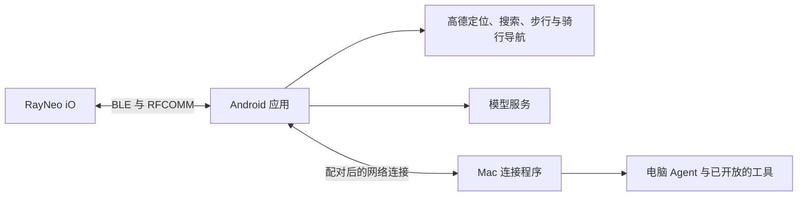

# Android 导航、Agent 与电脑互联实施方案

日期：2026-10-12。目标设备：小米 13，无 Root，Android 16 / HyperOS 3。本文是完整目标的实施与验收方案；当前实现进展如下。

当前决策覆盖下文原始方案：用户要求使用高德 App 直接导航，由 OpenRayneo 读取导航通知，取消自行接入导航 SDK。0.2.1-dev 已移除高德 SDK 与 Key 配置；手机模型仍为自行配置，电脑 Agent 仍为 Codex。0.3.0-dev 曾尝试导航与问答共用实时提示页，用户报告文字数秒后消失、音频仍继续。0.3.1-dev 按最新要求恢复字幕固定导航网格，尝试同时接收字幕音频；ASR 接入已暂停。实际进展和验证边界见 [高德通知导航](android-notifications.md)及 [配置说明](android-setup.md)。

2026-10-14，0.4.0-dev 已完成 Android 显示协调器重构：纯状态转移、类型化事件与效果、独立连接重试、显示所有权、回答返回目标、音频实际状态。构建、Lint 与 39 项临时回归通过；重构版眼镜验收仍待完成。详见 [状态机实现](android-state-machine.md)。

下文保留原始方案作为历史背景，其中导航 SDK、App 内地点搜索／算路不再是当前实施目标。眼镜语音、无线／跨网部署和长期后台验收仍未完成。

## 交付目标

交付一个可安装的 Android 应用和配套 Mac 连接程序：在中国大陆使用真实步行／骑行导航；手机独立运行 Agent 对话和工具调用；电脑在线时可提交任务、查看进度并把结果显示到眼镜。手机独立运行指不依赖电脑，路线规划及云端模型调用仍需要网络。

内部按模块实现、联调和测试，对用户按一个完整版本交付。平台权限、个人服务账号配置及真实眼镜／户外显示验收需要用户参与，不能用编译成功替代。

## 已验证的基础与缺口

- Android 0.1.3-dev 已完成系统配对、BLE 应用认证、配对状态 2，以及业务 UUID `99999999-9999-9999-9999-999999999999` 对应的 RFCOMM 通道 26。用户确认进入眼镜主页；通知传输亦已测试。
- Android 目前仅有前台连接验证页面，Activity 销毁会断连，尚无前台服务、定位、显示会话、模型客户端或网络 API。
- Mac `NavigationFrame.swift` 提供已实测的 20×5 方向／距离显示，当前数据为手动输入，尚无真实路线引擎。
- Mac 字幕、提示页、Opus 音频与工具 API 可作为协议迁移依据。现有 skill 是外部 Agent 的调用说明，并非可在手机直接运行的 Agent。
- Mac HTTP 服务和 skill 请求脚本当前只支持 loopback。手机电脑互联需要新增通信与执行适配，不能直接填电脑 IP 就使用现有服务。

## 系统结构

日常由手机唯一持有眼镜蓝牙连接。电脑通过手机显示结果，无需同时与眼镜配对连接。保留 Mac 直接连接眼镜作为独立使用模式；切换连接拥有者时先释放上一方连接。

## 模块和实现顺序

| 模块 | 实现内容 | 验收结果 |
| --- | --- | --- |
| 连接与后台服务 | 将连接从 Activity 迁入前台服务；UI 订阅状态；保存目标设备；受控重连；区分系统配对、BLE 认证、眼镜配对状态、RFCOMM 就绪 | 退出页面或锁屏后仍保持工作；眼镜重新开机后可恢复；不自动清除配对 |
| 眼镜显示与音频 | 移植字幕／提示页的 SID、启动回执、停止与切换；移植 20×5 导航及首帧／更新补偿；接收 Opus 并解码佩戴者声道 | 中文和方向箭头可见；旧会话不会覆盖新页面；眼镜语音输入可验证 |
| 手机导航 | 接入高德 Android 定位、搜索和导航 SDK；目的地候选选择；步行／骑行；转向距离、偏航重算、到达、GPS 弱提示 | 真实位置驱动眼镜画面；短途步行与骑行分别实测；不以模拟路线代替实测 |
| 手机 Agent | 可配置模型服务；流式对话、会话记录、取消；结构化工具调用；手机文字和语音输入；眼镜语音经 ASR 转文字 | 电脑关闭时仍能问答、查地点、开始／结束导航及显示结果 |
| 电脑互联 | Mac 配套连接程序、设备配对、任务提交／状态／取消／结果；适配指定电脑 Agent；手机接收结果并协调眼镜显示 | 同一 Wi-Fi 下完成真实任务；电脑离线不影响手机导航；重连不重复执行已接收任务 |
| 跨网络互联 | 在相同任务协议上使用用户配置的私有网络通道，例如 VPN；验证手机蜂窝网至电脑 | 外出可调用在线电脑；无需公开电脑终端端口；电脑休眠明确显示不可用 |

### 导航的实现依据

采用高德正式 SDK 的 `calculateWalkRoute`、`calculateRideRoute`、GPS 导航及导航回调。导航 SDK 负责路线推进、转向和偏航重算，应用把回调映射为眼镜画面。模型只帮助理解目的地和选择工具，不生成实时道路指令。搜索与定位结果使用服务要求的同一坐标体系，避免把 WGS84 坐标直接当成 GCJ-02。

手机展示目的地、路线、导航状态和退出入口，眼镜继续显示简洁的箭头、距离和动作。距离／动作不变时不重复写屏。GPS 弱、偏航重算、到达等状态需要清晰显示，不能把旧方向永久保留为有效指引。

官方依据：[高德步行／骑行路线规划与导航](https://lbs.amap.com/api/android-navi-sdk/guide/route-plan/ride-route-plan)、[导航 SDK 概述](https://lbs.amap.com/api/android-navi-sdk/summary)。集成时固定 SDK 版本，并核对该账号对所需功能的开通状态与调用额度。

### Agent 和显示冲突处理

手机内的 Agent 负责模型请求、工具调度、会话和取消。首批工具为地点搜索、导航启动／查询／结束、眼镜短通知／回答、电脑任务提交／查询／取消。语音识别单独适配；现有 Mac 的 Apple Speech 不能原样迁入 Android。眼镜音频的解码与 ASR 输入通道需要真机验证，不假设手机系统语音识别器能直接接收外部 PCM。

现有眼镜提示页启动会打开音频上行，导航使用字幕页；默认按互斥显示会话管理。导航中可使用手机语音输入；需要眼镜麦克风时暂时切换提示页，手机继续维护定位和路线，Agent 交互结束后重新建立导航显示会话。是否存在可同时保留两页能力属于后续协议研究，不作为本版依赖。

模型凭据在手机本地配置并加密存储，不写进 APK、日志或仓库。移动端只暴露已实现工具；无 Root 环境不承诺任意操作其他 App。

### 电脑互联

Mac 配套程序提供网络连接和受限任务入口，必要时在电脑本地调用现有 loopback API。两端首次配对确认设备并保存凭据，后续自动连接；通道使用加密传输或已配置的加密私有网络。业务消息包含请求 ID、任务 ID、状态及结果，重连时查询既有任务状态，避免自动重复启动有副作用的任务。

桌面 Agent 通过实际支持的 CLI／SDK／API 接入，使用独立任务会话。不能假定任意桌面聊天窗口提供远程操作接口，也不默认能够接管当前聊天上下文。最终适配器取决于用户指定的电脑 Agent。

优先打通局域网与 USB 调试下的联调通路，再验证私有网络上的蜂窝网访问。私有网络账号及跨网通道属于部署依赖；单纯使用 WebSocket 不会自动解决 NAT、电脑休眠或网络隔离。

## 外部配置依赖

1. 高德账号及 Android Key，匹配应用包名和稳定签名；搜索／定位／导航能力按实际 SDK 配置开通。应用初始化时提供 SDK 要求的隐私说明与同意入口，权限按使用功能请求。
2. 模型服务的供应商、地址、模型及凭据；选定模型应支持工具调用。只需在对话中确定服务名，真实凭据通过本地配置填写。
3. 电脑 Agent 的名称及可调用方式；如需要外出访问，再配置两端的私有网络通道。

先实施不依赖服务凭据的连接服务、显示会话、工具接口和通信协议；取得配置后接入真实路线与模型。缺少外部配置时明确标记功能待配置，不用固定答案或演示路线冒充完成。

## 完成标准

- 安装同一签名的最终 APK；普通未 Root 小米 13 可连接眼镜并进入主页。
- 断开重连及锁屏运行通过；测试中退出 App 页面不会立即断开导航。
- 在真实步行和骑行路线中核对目的地、转向、剩余距离和到达；模拟回放用于自动测试，现场显示由佩戴者核对。
- 电脑关闭时手机 Agent 仍能完成一次对话及导航工具调用；手机与眼镜输入均有明确工作状态和退出方式。
- 电脑在线时完成一次可核对结果的任务；断网、取消、重连不会悄悄重复执行。
- 任务返回时导航能够按设计恢复，显示与音频没有遗留会话。
- 自动验证覆盖连接状态转换、显示 SID／回执、导航状态映射和任务重连语义；阶段性实验代码不留到下一阶段。

此方案不把 Root、刷眼镜固件、系统虚拟麦克风或自行训练大模型作为依赖；不把桌面单进程代码直接复制到 Android。各平台共享协议和工具契约，实现各自的生命周期与平台能力。
