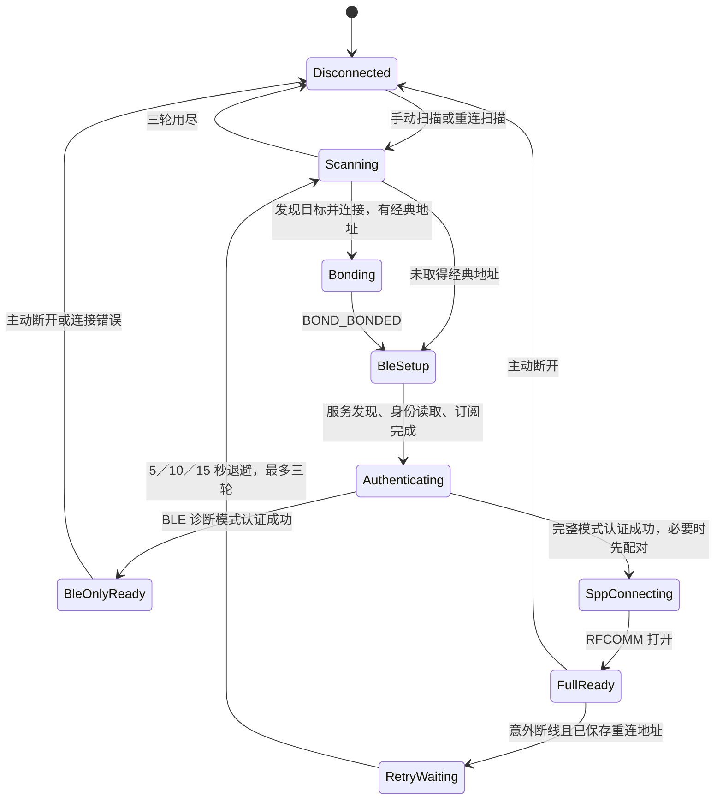
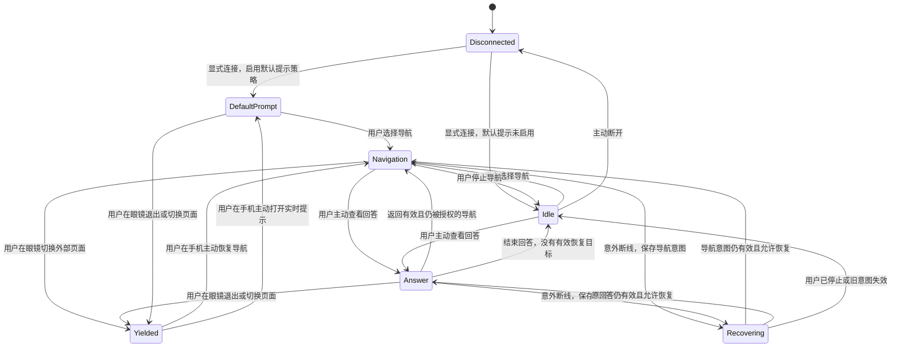

# Android 眼镜状态转移审计

日期：2026-10-14。历史审计基线：Android 0.3.3-dev（versionCode 11）。

后续实现：0.4.0-dev 已引入统一协调器，见 [状态机实现与验收](android-state-machine.md)。下文保留原始问题及当时建议，所述旧代码行号仅对应审计基线。

本次梳理连接、导航数据、显示会话、音频、Agent／Codex 回答及外部页面的交互，不修改应用运行代码。范围是当前框架涉及的状态，不代表已完整还原眼镜全部固件状态。0.3.3 曾构建但未取得安装验收；0.3.1 导航显示已获确认，字幕音频仍停留在等待状态；0.3.2 的 BLE 接收修复尚无真实音频成功记录。不能把代码审计、合成音或回放检查当成真机成功。

## 结论

问题来源是多份状态缺少统一协调：BridgeService 用 ready／promptPaused／answerVisible 决定打开什么页面，GlassesDisplay 用 mode／SID／blockedMode／accepted 管理协议，PromptAudio 另有 active／error／lastAudio。显示层失败或设备退出只报告字符串，没有把业务层的“正在显示回答”和恢复计时一起结束；业务层又以“没有导航”隐式选择默认实时提示。

0.3.3 修好了“停止跟随后马上打开实时提示”这条路径，但依靠全局暂停实现，仍未解决页面所有权、局部停止与全局停止、失败后重试、音频实际可用性和重连恢复的关系。

## 当前状态分层

| 层 | 现有状态 | 缺口 |
| --- | --- | --- |
| 连接 | ready、busy、connecting、reconnecting、reconnectScanning；底层 socket／GATT／generation | BLE-only 和完整连接共用 ready；连接原因主要藏在字符串中 |
| 导航输入 | 通知监听 connected、enabled、selectedKey、entries、可解析 instruction | 与眼镜页面是两回事；有导航意图不等于页面可用 |
| 业务显示意图 | promptPaused、answerVisible、导航是否 enabled | 没有明确的空闲、外部页面拥有、恢复目标或显示请求代数 |
| 页面协议 | NAVIGATION／PROMPT、SID、audioAccepted、accepted、settled、writing、blockedMode | 失败与设备退出不形成供业务层消费的结构化事件；没有关闭中 |
| 音频 | active、channels、packets、samples、lastAudio、error、generation | active 表示已请求启动解码，不代表实际收音；错误不反馈页面协调器 |
| 模型任务 | 各自的 generation／running、Codex turnID | 防护限定在各自客户端，不关联用户后来改变的眼镜显示意图 |

手机输入法／系统语音输入仍是另一条链路，不会自动消费眼镜音频。ASR 已按用户要求暂停。

## 连接状态：实际路径

阶段失败会经过底层 disconnect，服务根据是否意外断线决定是否重试。没有有效目标地址时不会自动重连。GATT 回调运行在主线程，SPP 读取结果也转回主线程；底层 generation 和 socket 身份用于拒绝旧连接回调。

## 显示启动：实际路径

导航：0x13 type 1 → 匹配 SID 的 type 2/code=1 → 启动单声道解码器 → 同 SID type 7 → type 8/code=1 且布局为 2／100／5 → 等待 500 ms → type 5/mode=3/status=1 网格。

实时提示：0x17 type 1 → 匹配 SID 的 type 2/code=1 → 启动双声道解码器 → 等待 500 ms → type 5/mode=4/status=1 标题／正文。

导航首帧不加补偿，之后整帧前补 U+3000；相同画面去重。音频独立于文字去重：audioAccepted 后，接收匹配协议及 SID 的 type 4，按最近 64 个业务 seq 去重后交给解码器。0.3.2 起同时分发 BLE 和 SPP 业务帧。

切换导航／实时提示会停止旧 SID，再创建新 SID；它们不是两个同时独立拥有屏幕的页面。停止时先清本地状态，再异步写 type 3；代码没有“关闭已确认”状态。

## 用户与后台事件：实际行为

| 事件 | 当前行为 | 评价 |
| --- | --- | --- |
| 完整连接成功 | 导航 enabled 时打开导航，否则打开默认实时提示 | 默认实时提示曾获用户授权，但应限定为连接策略，不能作为所有空闲分支 |
| BLE-only 认证成功 | 同样给服务 ready=true，服务也尝试打开页面 | SPP 发送会拒绝，随后进入显示错误 |
| 选择导航通知 | 清 answerVisible、取消恢复计时；若全局暂停则解除，再 follow | 正常路径可用；不一定解除 blockedMode |
| 选中通知更新 | 非回答状态时 showNavigation | 导航状态正常时仅更新画面；所有候选通知也会触发观察者 |
| 通知移除、解析失败、监听断开 | 用固定网格状态替代旧转向 | 防止继续显示旧方向的处理正确 |
| 手机 Agent／Codex 完成 | ready 且未暂停就设 answerVisible=true 并 showPrompt | 没有等待页面成功；没有关联新的显示意图 |
| 导航期间显示回答 | 切到实时提示；提交请求后 12 秒准备恢复导航 | 计时未从页面成功／实际呈现开始；不核对恢复时的所有权 |
| 结束眼镜回答 | 清 answerVisible，调用 showNavigation | 有导航则恢复；无导航则变成默认实时提示，继续收音 |
| 停止眼镜跟随（0.3.3） | 全局暂停、清回答状态、取消计时、停止显示／音频，再禁用导航 | 修正了原来的自动实时提示，但停止范围扩大至所有眼镜回答 |
| 暂停眼镜显示与收音 | 全局暂停，保留连接与导航 enabled | 通知仍接收；以后显式恢复 |
| 恢复眼镜导航显示 | 实际调用通用 resumePrompt | 导航已停止时会进入实时提示，与按钮名称不符 |
| 主动重新显示某个回答 | 如已暂停则解除，显示该回答 | 可用；和新提问自动回显的规则不一致 |
| 眼镜发当前 SID 的 type 3 | 底层 stop，并只封锁原 mode | 服务的 answerVisible、暂停位、恢复计时未同步 |
| 眼镜进入内置提词器 | 0x14 事件不进入当前显示控制器处理 | 没有“外部页面拥有显示”状态；不能保证不干扰 |
| 意外断线再重连 | 清 answerVisible，重连后按 enabled／promptPaused 重新选页面 | 不恢复原回答；也没有完整区分外部退出／主动空闲 |
| 断开眼镜 | 清重连目标，异步发显示停止后立即断开蓝牙 | 停止命令可能尚未写出 |
| 停止服务 | 断开、禁用导航、取消手机任务、关闭 Codex 连接 | 停止本地链路；眼镜最终页面不能仅由本地状态断言 |

## 确认的问题

### 1. 设备退出只封锁一种页面，另一种仍可自动打开（高优先级）

路径：导航开启 → 显示回答 → 眼镜退出实时提示 → GlassesDisplay.fail 只记录 blockedMode=PROMPT → 服务 12 秒回调仍调用 showNavigation → 导航模式不同，允许重新启动。

同时 answerVisible 仍可能为 true，导航通知更新被抑制。没有导航时甚至可能一直保持“业务层以为在显示回答、协议层已没有会话”的组合。

证据：BridgeService.kt:35、41、158；GlassesDisplay.kt:44、89、152。低层事件回放确认“同模式被挡、不同模式仍启动”；服务计时回调路径由代码确认。

修正方向：设备结束／用户让出显示产生统一的释放事件，同时更新业务意图、会话、恢复目标和计时。已手动让出的控制权不能被旧计时器重新取得。

### 2. 停止导航被实现成全局暂停（高优先级）

路径：停止眼镜跟随 → promptPaused=true → 之后用户新发手机／电脑任务 → 回答在手机正常完成，但 showAnswer 直接返回，不显示到眼镜；要额外点“重新显示回答”才解除。

若当前正在查看 Agent 回答，停止导航也会把当前回答与收音一起结束。停止导航、暂停全部显示、结束回答应有独立语义。

证据：BridgeService.kt:136、150、158、164；MainActivity 的发送按钮只提交任务，没有重新授权显示。

### 3. 导航恢复按钮可能打开实时提示（明确的入口错配）

路径：停止导航 enabled=false → 点击“恢复眼镜导航显示” → resumePrompt → showNavigation → 默认实时提示。

证据：MainActivity.kt:106；BridgeService.kt:141、149。该现象仍存在于 0.3.3，和上一版修掉的“停止按钮立即跳转”不是同一条路径。

修正方向：恢复导航应恢复导航订阅或提示先选通知，不能隐式打开其他模式。

### 4. 页面错误不反馈业务层，显式重试可能被忽略

showAnswer 在请求页面前就把 answerVisible 设为 true；启动超时／拒绝／文本发送失败后只收到报告字符串，标记仍为 true。blockedMode 又会直接吞掉同模式 show 请求。选择新导航通知只在 promptPaused=true 时 stop/reset，因此导航启动失败后直接重新选择通知可能仍不启动。

证据：BridgeService.kt:59、130、158；GlassesDisplay.kt:44、94、113、142、152。回放确认失败后普通跟随请求被忽略，而显式 stop/reset 可恢复。

### 5. 迟到回答和两个模型客户端可以改变当前页面

手机 Agent 与 Codex 都直接调用同一个 showAnswer。用户发起请求后切回导航、改变正在看的回答，甚至断连后重连，只要最终回调时 ready=true 且 promptPaused=false，旧请求仍能切到实时提示。后完成的另一个客户端也会替换当前回答、重置 12 秒计时。

各客户端的 generation 能防自己已取消请求的回调，但没有与眼镜页面的意图代数关联。

证据：BridgeService.kt:65、66、158；MobileAgent.kt:71；CodexClient.kt:156。

修正方向：给自动回显携带请求 ID、显示授权代数和恢复目标；用户切页后旧完成事件默认只更新手机结果。显式重看历史回答是新的显示请求。

### 6. “已连接”“已开启”和真实收音被混用

通知栏只检查 ready && !promptPaused 就写“眼镜显示与收音已开启”。启动未确认、页面拒绝、音频零包甚至解码器失败时都可能保留该文案。BLE-only 也用 ready=true，但不能发送这些 SPP 页面控制。

PromptAudio.active 在解码器配置前置 true；“等待音频”由最后成功 PCM 的时间决定，无法区分从未收到包、收到但还未输出 PCM和后来断流。它没有直接把这些状态同步给业务层。

证据：BridgeService.kt:184；RayneoConnection.kt:295、416；PromptAudio.kt:19、47、69、96、98。

修正方向：连接能力、页面确认、音频接收、解码分别显示；界面只按实际状态描述。音频失败应允许导航继续，不自动重开整个页面。

### 7. 关闭命令尚未写出就断开链路

BridgeService.disconnect 依次调用 display.stop 和 connection.disconnect。stop 的写入排在 IO executor，后一调用立即置空并关闭 socket。工作线程可能在真正写出停止包前检查到 socket 已变化，导致停止消息未送达。这是代码中的调度竞争，不代表每次都会失败；眼镜也可能自行在断链后关闭页面。

证据：BridgeService.kt:92；GlassesDisplay.kt:146；RayneoConnection.kt:416、441。

修正方向：主动退出有有限的收尾阶段，至少等待停止包写完，再断开；超时仍能强制断开并标记眼镜实际状态未知。

### 8. 重连能力与恢复意图都不完整

目标地址只取初次 Device.classicAddress；通过身份特征稍后取得经典地址的设备即使已连接，服务仍可能没有重连目标。若重连扫描因蓝牙关闭直接抛错，retry 只记日志，没有重新排程或等待蓝牙开启事件。成功重连又只按导航 enabled／暂停位选择页面，不知道中断前是回答、明确空闲还是眼镜外部模式。

证据：BridgeService.kt:48、83、105；RayneoConnection 的身份读取与 expectedAddress 更新路径。

### 9. 首次自动跟随可以覆盖“停止”的输入状态

如果 selectedKey 仍是 null 时先停止跟随，之后第一次收到可解析通知，NavigationFeed.update 仍调用 follow，把 enabled 重新置 true。0.3.3 的 promptPaused 暂时阻止开屏，但底层跟随意图已被反向修改；服务重建后可能重新打开导航。

证据：NavigationNotifications.kt:48、61。需要区分“从未选择过”和“用户明确停止”，不能仅凭 selectedKey 是否为空判断。

## 协议覆盖缺口与实测边界

- 当前接收器忽略非当前业务协议，内置提词器、固件主页、其他外部应用的所有权没有完整处理。回放只能证明处理器忽略外部事件，不能证明每次手动进入提词器时固件一定发某一固定事件。
- 字幕所有 type 3 都按结束处理，没有区分 reason_code。固件研究显示该类消息还涉及暂停、恢复及录音控制；应先还原原因枚举，再分类处理，不能把所有消息一律等同于用户退出。
- mode 切换是连续写旧 stop 与新 start，不等待远端释放。源码字符串显示固件有退出门禁和非空闲拒绝路径，因此需要实测确认切换时序；目前没有证据把具体超时归因于它。
- 默认实时提示在连接时启动是此前用户明确要求，不能在重构中悄悄删除。需要与“用户主动停止后保持空闲”的优先级分开记录。
- 导航等待通知、无法解析或监听断开时替换旧箭头，这部分正确。通知 key 变化后需重新选择，目前属于已说明的限制。
- SID 过滤、旧连接 generation、解码 generation、首帧等待、布局确认、BLE/SPP 音频有限去重应保留。
- 当前 PCM 消费只算音量，没有 ASR。单声道／双声道解码的合成测试不证明实际字幕音频已到达。

## 建议的目标状态（尚未实现）

不需要把所有组合展开为一个巨大枚举。保留四组正交状态，由一个控制器协调：

| 维度 | 状态 |
| --- | --- |
| 连接 | 未连接、扫描／配对／认证、BLE 诊断可用、完整连接、重连等待、关闭中 |
| 用户显示意图与拥有者 | 连接默认提示、明确空闲、导航、主动查看回答、已让出给眼镜外部页面 |
| 协议会话 | 无会话、等启动确认、等导航布局、等待稳定、可写入、关闭中、失败 |
| 音频 | 停止、等待首包、有包待 PCM、正常接收、断流、解码失败 |

导航数据监听和模型任务独立存在，只有协调器决定是否拿这些数据更新眼镜。模型完成、通知变化、重连回调不能自行开新页面。

这是建议规则，不是已经变更的默认行为。导航期间是否自动让位给新回答，以及回答停留时间，需要统一为产品规则；建议导航优先、自动回答先留手机，主动查看才临时切页。若继续保留自动显示，则必须使用相同的显示授权与恢复目标检查。

建议事件优先级：用户主动停止／让出控制 > 新的显式显示请求 > 当前页面有效内容更新 > 后台模型结果与自动恢复计时。停止导航只停止导航意图；暂停全部显示才影响所有页面。退出消息不应默认触发另一种页面。

## 修改顺序与验收

1. 先统一显示意图及页面所有权，修正停止／恢复／结束回答的语义；保持现有绘制和蓝牙协议不变。
2. 用结构化事件回传启动成功、拒绝、退出和写入失败；替代 answerVisible 的乐观标记，加入有限关闭阶段。
3. 恢复计时和模型自动回显带显示代数，防止过期事件抢回页面；补齐重连目标、恢复意图和用户停止优先级。
4. 单独观测音频包到达与 PCM 输出。无音频或解码失败不影响已验证的导航显示，再确认字幕音频是否真实可用。
5. 查清固件外部页面／暂停／恢复事件后，接入提词器让出规则。ASR 继续暂停。

回归场景应覆盖：连接默认提示；首次导航；导航通知变化；通知丢失；停止后持续收通知；停止后新提问；结束回答有／无导航；页面拒绝后显式重试；眼镜退出回答但恢复计时未到；眼镜进入提词器；两个客户端乱序完成；断线前后用户停止；服务重建；BLE-only；解码失败但导航正常；主动断开时旧 stop 未写完。

## 本次验证

只读检查当前 Kotlin 与相关 Swift 状态逻辑，并用当前编译的 GlassesDisplay 回放三个事件序列：A，眼镜退出实时提示后请求导航仍会新建 SID；B，启动拒绝后普通同模式请求被忽略，stop/reset 后可恢复；C，提词器消息不改变当前跟踪的提示会话，随后仍会发送提示更新。回放没有连接眼镜，不是固件验收。临时 Java 源码完成后移入废纸篓。

Mac 参考：DesktopBridge.prepareDisplay 只有在 accepted=true 后才设置 activeSession，这比 Android 的乐观 answerVisible 更明确；但它不能作为外部模式同步、长时间文字常驻或安卓字幕收音的成功依据。
