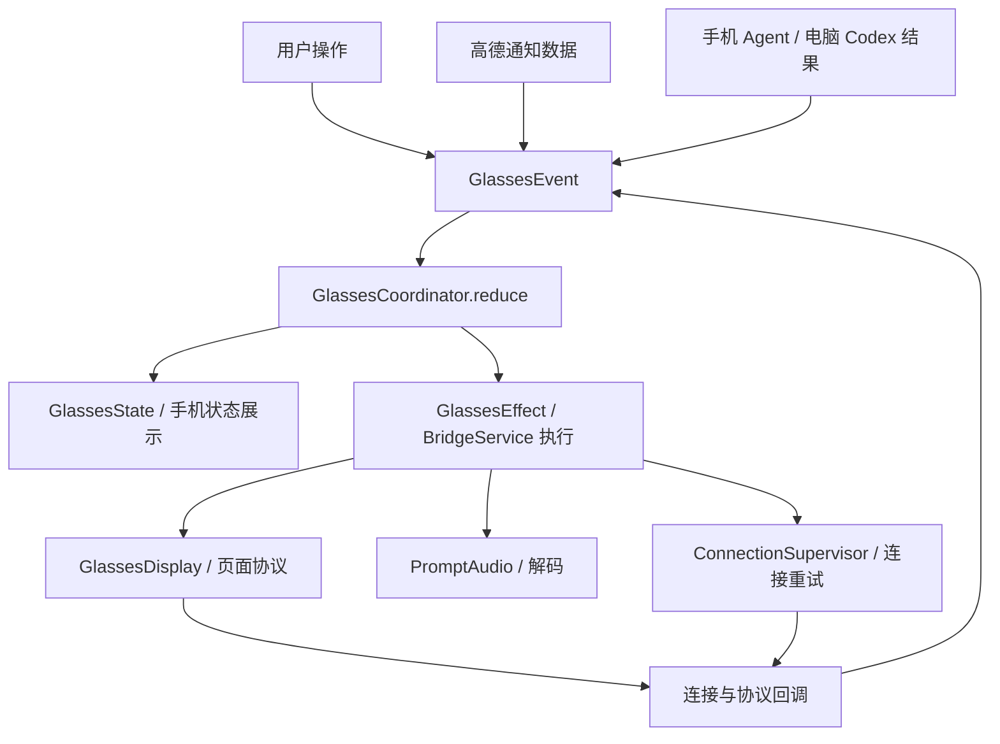

# Android 眼镜协调器

实现版本：0.4.0-dev（versionCode 12），2026-10-14。此前问题与复现依据保留在 [0.3.3 状态审计](android-state-audit.md)。本次重构 Android 显示控制链路；ASR 继续暂停，未实现全天智记、语音唤醒或提词器控制。

0.5.0-dev 在此协调器上接入 Material 3 界面，新增引导及界面偏好，不修改显示意图枚举。服务在浏览阶段仅绑定，实际连接眼镜时才进入前台运行，详见 [界面说明](android-ui.md)。

## 唯一决策入口

`GlassesCoordinator.reduce(state, event)` 是不依赖 Android 的纯函数，返回新状态和待执行效果。只有它决定眼镜页面。`BridgeService` 在主线程使用 FIFO 事件队列，先提交状态再执行效果；效果产生的同步回调入队，不能在旧状态上重入。

| 模块 | 职责 |
| --- | --- |
| `GlassesState.kt` | 意图、所有权、连接、页面、音频和事件／效果类型 |
| `GlassesCoordinator.kt` | 选择目标、切换顺序、回答资格、恢复与失败策略 |
| `BridgeService.kt` | Android 生命周期、串行事件队列、效果执行和定时器 |
| `ConnectionSupervisor.kt` | 蓝牙连接状态映射、5／10／15 秒退避与最多三次重连，不选择页面 |
| `GlassesDisplay.kt` | SID、握手、布局、写入、关闭及音频包分发，不决定后续打开哪个功能 |
| `PromptAudio.kt` | Opus 解码、音量、音频实际状态；音频失败不自动关闭导航 |
| `NavigationFeed` | 通知选择、解析、过期清理与持久化跟随设置，不直接操作显示 |

## 状态的含义

`DisplayIntent` 只有 `Idle`、`PromptStandby`、`Navigation`、`Answer(ref, returnTo)`。`Answer` 的返回目标是空闲、实时提示或导航；任务来源和编号另存为 `AnswerRef`。提词器等外部页面通过 `DisplayOwnership.YIELDED` 表达已让出控制，不编造成已实现的应用功能。

连接使用 `LinkPhase`，明确区分 BLE 诊断就绪和完整连接。页面使用带编号的 `PageSession`，经历启动、布局、稳定等待、就绪、关闭中。`READY` 表示协议握手完成且内容写出，**不证明眼镜物理屏幕已显示**。音频另分停止、等待首包、有包待 PCM、接收、断流、失败，不能用页面启动回执代替音频到达。

## 事件与用户行为

| 事件／操作 | 结果 |
| --- | --- |
| 显式连接 | 有已启用的导航则选择导航，否则选择已授权的默认实时提示；BLE-only 不开启显示或音频 |
| 首次自动选择导航通知 | 只允许把当前默认实时提示切到导航；明确空闲或已让出时不抢屏 |
| 选择通知／恢复眼镜导航 | 明确选择导航；没有有效已选通知时提示重新选择，不退回实时提示 |
| 通知更新 | 更新导航数据；仅当目标是导航时写屏，不覆盖正在查看的回答 |
| 停止眼镜跟随 | 禁用通知跟随；当前导航变空闲；当前回答继续，但其导航返回目标改为空闲 |
| 暂停眼镜显示与收音 | 目标变为空闲；旧任务和计时器失效，通知仍可在手机接收 |
| 打开实时提示与收音 | 明确选择实时提示，独立于是否存在导航数据 |
| 新问题完成 | 只有最新请求仍持有当前意图版本的显示资格、完整连接且未让出时自动显示 |
| 结束眼镜回答 | 回到进入回答时记录的目标；导航已停止则回空闲；没有回答时无操作 |
| 导航期间回答写出 | 从匹配内容的写入完成起计时 12 秒，按会话编号、意图版本和回答编号核对后恢复导航 |
| 眼镜结束当前页面 | 清理页面、音频、回答资格和计时器，转空闲并让出；需要主动选择功能恢复 |
| 重启音频解码 | 只重启当前已确认会话的本地解码器；不关闭页面、不发送新的蓝牙启动命令 |
| 意外断线 | 清理会话和音频、作废未完成回答的显示资格；自动重连后按保留的意图与所有权恢复 |
| 主动断开 | 取消重连；等待页面关闭命令写完或关闭超时，再断开蓝牙 |

空闲不是永久禁用回答。停止或暂停之后新发起的问题可以取得新的自动显示资格；停止前已经运行的任务不能凭旧资格重新占屏。外部页面已拥有显示时，即使新任务完成也不自动抢回，用户可主动“重新显示回答到眼镜”。手机和电脑同时请求时，最近发起的请求持有自动显示资格，各自回答仍保留在手机。

新建手机对话、重连／新建电脑会话、修改相应连接配置会取消旧显示资格。客户端本身的任务取消及回调代数继续负责隔离旧请求。

## 切换、失败与迟到事件

跨协议页面切换先进入 `CLOSING`，停音频，再写旧 SID 的停止命令。关闭写入完成后，按**此刻最新意图**启动页面；切换中再次点击停止不会打开先前排队的目标。相同模式只更新内容，导航通知不重建 SID。

关闭等待上限为 1500 ms。正常关闭完成仅证明传输写完，不是固件退出确认；超时／发送失败时停止盲目启动下一页，显示“实际页面未知”，由用户主动重试。断开操作在超时后仍释放蓝牙。启动／布局失败封锁当前意图版本的自动重试，通知更新不能反复启动；主动选择功能可以解除。

页面编号隔离协调器回调，随机 SID 隔离蓝牙协议，执行器 generation 隔离关闭回调，回答编号＋意图 revision 隔离旧任务和恢复定时器。写入中收到连续导航更新会合并为最新内容。音频继续按已确认 SID 接收，BLE/SPP 使用最近 64 个业务 seq 去重。

## 外部页面证据与限制

当前接收器遇到 `0x14` 非空 type 9 音频，或带非空 `did` 且未报告失败的 type 2／3／5／8 时，保守地让出显示。连续此类消息在已让出后不重复清理，也不向提词器发送关闭命令。这是基于已知提词协议的活动判断，**不是完整的物理页面状态查询**；延迟消息和所有固件组合仍需实测。未知协议事件不能证明当前前台页面。

固定导航继续沿用 0x13 启动→布局确认→500 ms→20×5 网格；问答继续使用 0x17。布局补偿、路名裁切与实际通知解析不改变。真实字幕音频是否到达仍待验证；重启本地解码器不能使原本未发音频的眼镜开始发送。所有 PCM 仅在内存计算音量，不保存、不上传、不进入系统 ASR。

## 本地验证与真机验收

构建、Lint 与 39 项临时回归通过：26 项纯协调器测试、13 项真实协议执行器与协调器联测。覆盖停止后的迟到通知／回答、两个任务来源竞争、写出后计时、设备退出、关闭中的目标变更、关闭超时、断线后的旧回调、布局拒绝、首帧等待和补偿、BLE/SPP 音频去重、连续提词器活动、独立音频重启。临时测试源码在本阶段完成后移入废纸篓，不成为下一阶段依赖。

这些检查未使用真实眼镜，不能替代以下安装验收：

1. 完整连接并恢复高德通知导航，确认箭头、距离、路名保持显示。
2. 点击停止眼镜跟随，等待至少 15 秒且让高德继续更新；确认不自动进入实时提示。
3. 停止后新发 Agent／电脑任务，确认可显示新回答；结束后返回空闲。
4. 导航中查看回答，写出后约 12 秒恢复导航；期间若在眼镜退出，不能被计时器重新拉回。
5. 开启内置提词器后核对手机“已让出”状态；主动选择导航才能恢复。
6. 单独记录音频是等待首包、有包待 PCM 或正常接收；音频错误不应清空正常导航。

锁屏长时间、户外路线和无线部署继续按此前决定留待后续验收。

## 0.5.1 已写出内容

页面会话新增 `writtenContent`，记录同一会话最近完成写入的逻辑内容；`content` 仍是最新目标。UI 根据二者区别显示待发送、更新中和已写出。新的会话没有历史预览，断线或让出会清除预览；模式切换等待关闭时保留原会话状态。该字段不参与选择目标，不改变既有蓝牙协议，也不代表设备屏幕截图。完整界面规则见 [UI 说明](android-ui.md)。
